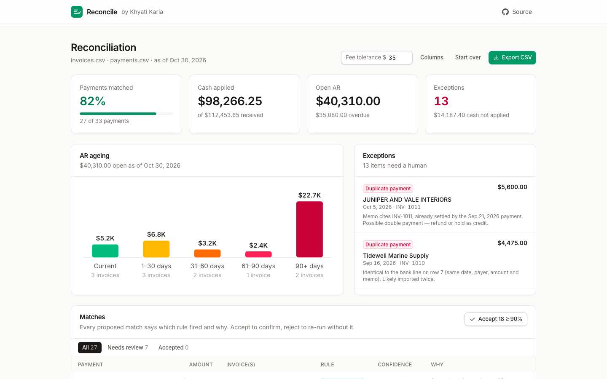
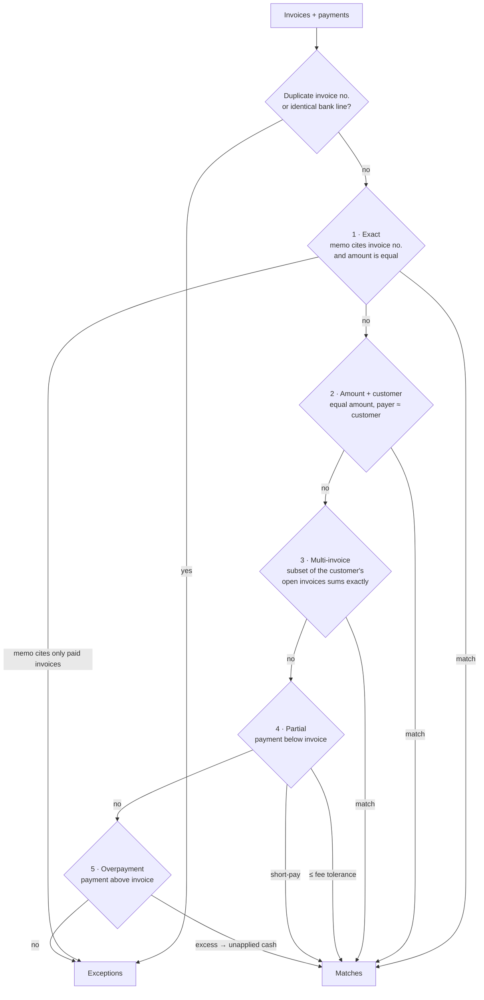

# Reconcile — invoice → payment matcher

**[Live demo →](https://khyati-invoice-matcher.vercel.app)**

Cash application is the unglamorous job of working out which bank payment pays which invoice. Remittances cite the wrong number or none at all, customers pay three invoices in one transfer, banks shave off a wire fee, and someone always pays twice. **Reconcile** takes a CSV of open invoices and a CSV of bank receipts and runs a deterministic, explainable matching engine over them. It tags every match with the rule that fired and a confidence score, puts what it can't explain in an exceptions queue, ages what is still owed, and drafts the follow-up emails. It all runs in the browser: no server, no API key, no AI.



## How matching works

The engine (`lib/match/`, plain TypeScript with no UI dependencies) runs in passes, from most certain to least. Each pass only sees the payments and invoice balances that earlier passes left unmatched, so a confident explanation always beats a speculative one.



| Pass | Rule | How it decides | Confidence |
| --- | --- | --- | --- |
| 0 | duplicates | Repeated invoice numbers and identical bank lines (same date, payer, amount and memo) are set aside | — |
| 1 | `exact` | Memo cites one or more open invoice numbers (`INV-1042`, `inv 1042`, `INV1042`, or a unique `1042`) and the amount equals their balance | 95–100% |
| 1b | double payment | Memo cites only invoices that are already settled, so it becomes an exception instead of being dumped on another invoice | — |
| 2 | `amount_customer` | Same amount, and the payer fuzzy-matches the customer. The oldest invoice wins if several share the amount, and the match is flagged *ambiguous* | 55–90% |
| 3 | `multi_invoice` | Bounded subset-sum over that customer's open invoices (oldest 16, 50k-node budget) finds the combination that adds up to the cent | 60–97% |
| 4 | `partial` | Payment is below the cited or closest invoice. A gap within the fee tolerance (default $35) is written off as a *bank fee*. A bigger gap is a *short-pay* and the remainder stays open | 50–92% |
| 5 | `overpayment` | Payment exceeds the cited or best-fitting invoices. They are settled and the excess is held as *unapplied cash* | 45–85% |
| 6 | exceptions | Unknown payers, cash from a customer with nothing open, and overdue invoices with no payment at all | — |

**Customer names** are normalised before comparison: lower-cased, `&` treated as "and", punctuation and legal suffixes (`Inc`, `LLC`, `Ltd`, `P.C.` …) dropped. They are then compared as token sets, using the better of the Dice coefficient and a discounted containment score. Tokens of five or more letters also match on prefix or one typo. As a result, `JUNIPER AND VALE INTERIORS` matches `Juniper & Vale Interiors`, and `Tidewell Marine` matches `Tidewell Marine Supply`.

**Payments dated before their invoice** are still matched, but they are flagged and lose 10 points of confidence. **Rejecting** a match re-runs the engine with that exact pairing banned, so the payment can fall through to its next-best explanation.

## Features

- Drag-and-drop CSV upload, or one-click realistic sample data (41 invoices across 12 fictional customers, 33 bank lines) that exercises every rule, flag and exception
- Column auto-mapping from header synonyms (`Posting Date`, `Counterparty`, `Credit`, `Memo` …) with a dropdown override step
- Tolerant parsing: quoted fields, `;`/tab delimiters, BOMs, `$1,234.50`, `(80.00)`, `USD 99`, ISO / US / `31-Oct-2026` dates
- Summary tiles: payments matched, cash applied, open and overdue AR, exceptions
- Matches table with rule badge, confidence bar, plain-English explanation, accept / reject, "accept all ≥ 90%" and a *needs review* filter
- Adjustable bank-fee tolerance, with live re-matching
- Exceptions queue and an AR ageing chart (current / 1–30 / 31–60 / 61–90 / 90+), drawn in plain SVG
- **Draft reminder** for any overdue invoice. The template's tone escalates with age (friendly → firm → urgent → final notice), and part-payments are acknowledged. Copy it to the clipboard
- Export a posting-ready CSV: one row per allocation plus every exception, with formula-injection-safe cells
- All money is held in **integer cents** and parsed from strings without touching floats
- Light and dark mode follow the system, and the layout is responsive down to 375 px (tables scroll inside their cards)

## Privacy

Your files are read with the browser's `File` API and processed in memory on your machine. Nothing is uploaded, stored or sent anywhere, and the app has no backend to send it to. Closing the tab discards everything.

## Tech stack

- [Next.js 16](https://nextjs.org) (App Router, statically prerendered) · React 19 · TypeScript (strict)
- Tailwind CSS v4 · Inter via `next/font`
- [Vitest](https://vitest.dev) for the engine's unit tests (95 tests)
- [Playwright](https://playwright.dev) for the README screenshot

## Run locally

```bash
npm install
npm run dev          # http://localhost:3000
npm test             # engine unit tests
npm run lint
npm run build
```

To regenerate the screenshot:

```bash
npx playwright install chromium   # once
npm run build && npm run start -- -p 4802 &
npm run screenshot                # writes docs/screenshot.png
```

## Deploy to Vercel

The app is fully static, so there are no environment variables to set.

```bash
npx vercel           # preview
npx vercel --prod    # production
```

Alternatively, import the GitHub repository at [vercel.com/new](https://vercel.com/new) and accept the defaults.

## Project structure

```
app/                     layout (header, footer, fonts) and the single page
components/
  reconciler.tsx         state machine: upload → column mapping → results
  upload-step.tsx        drop zones + sample loader
  mapping-step.tsx       column-mapping override
  results/               summary tiles, matches table, exceptions queue,
                         ageing chart, overdue table, reminder dialog
lib/match/               the engine (framework-free)
  engine.ts              the matching passes
  names.ts               name normalisation + token-set similarity
  references.ts          finds invoice numbers in free-text memos
  subset.ts              bounded subset-sum / best-fit search
  csv.ts · money.ts · dates.ts · columns.ts
  ageing.ts · reminder.ts · export.ts
  __tests__/             Vitest suites, including a sample-data snapshot
public/samples/          fictional invoices.csv and payments.csv
scripts/screenshot.mjs   Playwright capture for this README
```

All company names and figures in the sample data are invented.
